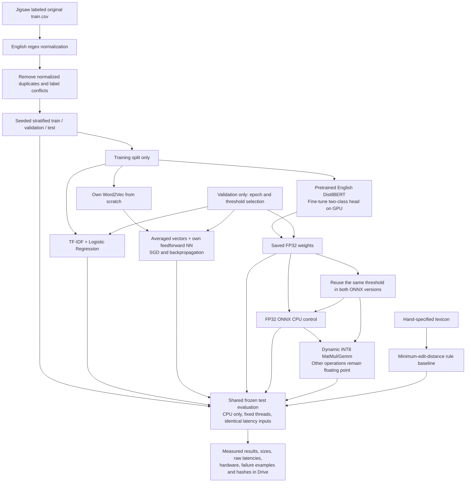
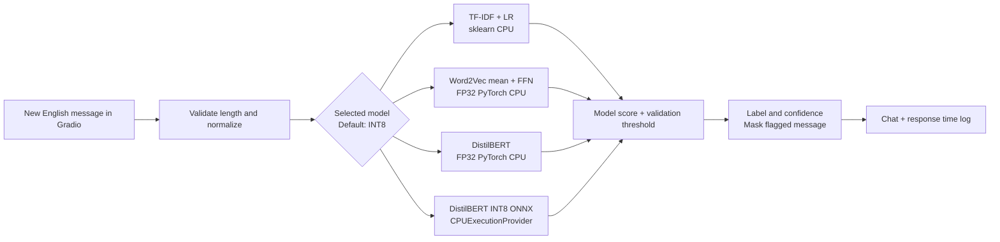

# English moderation architecture

The offline experiment runs in Google Colab. Trained artifacts and evidence persist in the student's Drive. The app can run inside Colab for interactive checking, or on a CPU after restoring the exported bundle. No model is trained on the student's computer.

The UI classifies one message at a time and does not infer from chat history. Model loading is excluded from both displayed response timing and the formal warm benchmark. Formal latency includes preprocessing and score postprocessing but excludes browser/network time. Artifacts include tokenizer and Word2Vec dependencies when size is measured.

